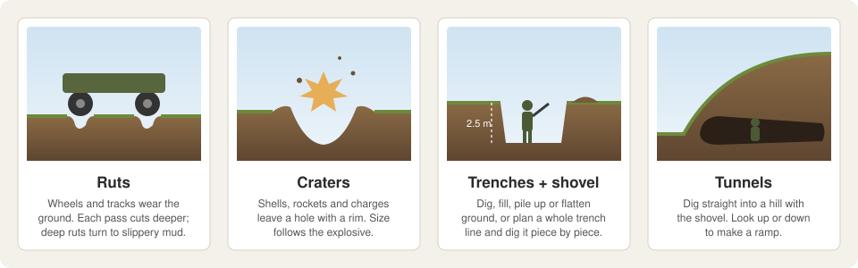
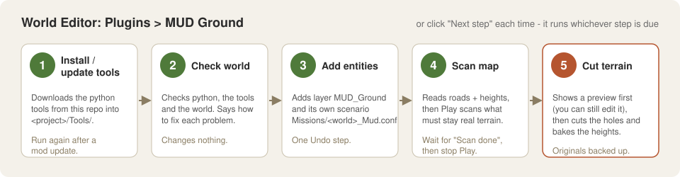
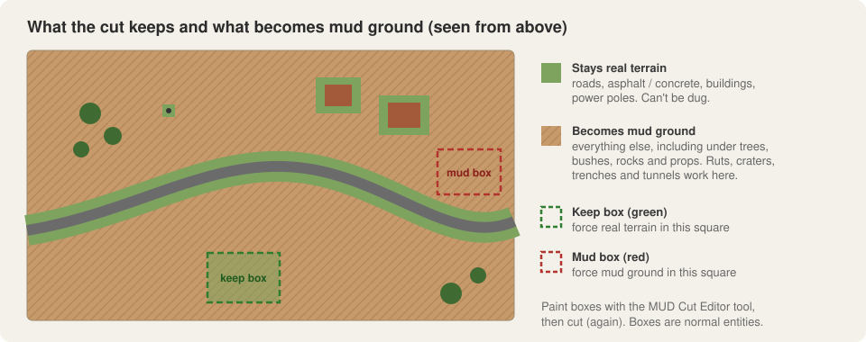
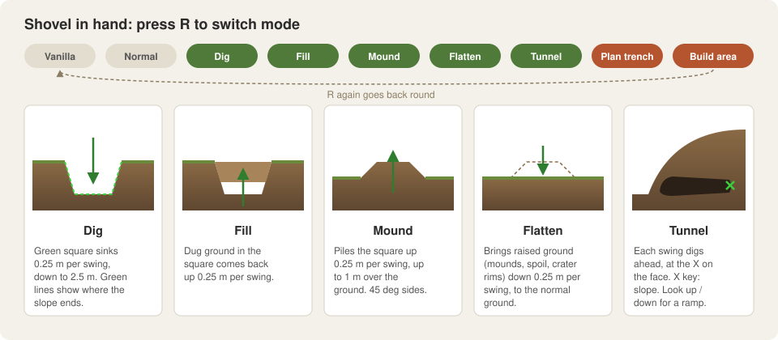
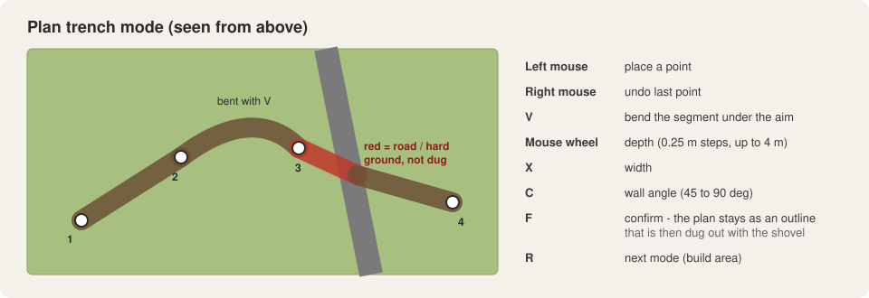

# Arma Reforger Terrain Deformation - map maker tools

Deformable ground for your Arma Reforger map: vehicle ruts, craters, trenches, shovel digging and tunnels.

The ground system itself is the Workshop mod
**[Terrain deformation](https://reforger.armaplatform.com/workshop/6A940DE9528954EE-Terraindeformation)**
(GUID `6A940DE9528954EE`). It comes with a ready Arland scenario and the World Editor plugin that builds the system
into your own world. This repo holds the python tools that plugin runs (source in [`Tools/`](Tools)). They can't run
from inside the Workshop download, so the plugin downloads them into your project from this repo's
[Releases](https://github.com/steffenbk/Arma-Reforger-Terrain-Deformation-Builder-Plugin/releases) - one release per
tools version (`tools-v<n>`), each with its zip.

**Contents**
- [How it works](#how-it-works)
- [What you need](#what-you-need) and [Setup](#setup)
- [Build the ground into your world](#build-the-ground-into-your-world)
- [Choose what stays real terrain](#choose-what-stays-real-terrain)
- [Other menu entries](#other-menu-entries)
- [In game: what players can do](#in-game-what-players-can-do)
- [Server settings](#server-settings)
- [Good to know](#good-to-know)

## How it works
Reforger's own terrain can't be changed while the game runs. So the build cuts holes in the map's terrain and fills
them with the mod's own ground, which can be dug, blown up and driven into ruts. Roads, buildings and power poles keep
the real terrain under them, so they look and work exactly as before.

You do this once per map in the World Editor. After that every player sees the same ground; changes are sent to
players who join later.

## What you need
- Arma Reforger Tools (Workbench) from Steam.
- Python 3 from python.org. Tick **Add python.exe to PATH** in the installer.
- Your own Workbench project.

## Setup
1. Subscribe to [Terrain deformation](https://reforger.armaplatform.com/workshop/6A940DE9528954EE-Terraindeformation)
   and add it to your project's dependencies in Workbench.
2. Restart Workbench, so it loads the mod and finds python.
3. In the World Editor: Plugins > **MUD Ground** > **1: Install / update tools**. It downloads the tools that match
   your mod version into `<your project>/Tools/` (older files are kept in `Tools/old_tools/`). Run it again after a
   mod update.

No internet in Workbench? Download the zip from
[Releases](https://github.com/steffenbk/Arma-Reforger-Terrain-Deformation-Builder-Plugin/releases) by hand (the
version **2: Check world** asks for) and unzip it into your project's folder, so you get
`<your project>/Tools/mud_build.py` next to your `addon.gproj`.

## Build the ground into your world
Make your world a SubScene of a game map (Arland is tested; maps from other mods work too), open it in the World
Editor and save it. Then run the steps in Plugins > **MUD Ground**, in order - or click **Next step** each time, it
runs whichever step is due.

1. **1: Install / update tools** - see [Setup](#setup).
2. **2: Check world** - checks python, the tools and the world, says how to fix each problem, then shows what of
   the ground system is in this world. Changes nothing.
3. **3: Add entities** - adds the ground entities (layer `MUD_Ground`, one Undo step) and makes the world its own
   scenario (`Missions/<world>_Mud.conf`), so it shows up in the game's scenario list.
4. **4: Scan map** - first a small dialog:
   - **Road destruction** - on: roads and asphalt / concrete get the mod's ground too, so they can be cratered.
     Off: they stay real terrain. Some decal roads and runway markings don't work well with this on (the dialog
     counts them for your map) - check your roads in game.
   - **Road safety** (0-4) - how many extra rings of real ground stay around kept roads. 1 is normal; 0 is tight
     (road edges may show gaps); higher = a wider strip nobody can dig.
   - **Keep ground under** - tick kinds of objects that should keep real terrain under them. They load faster, but
     that ground can't be dug. Nothing ticked = only buildings and power poles.

   Then it reads roads and heights and starts Play to scan what must stay real terrain. Wait for **Scan done**, then
   stop Play.
5. **5: Cut terrain** - shows a preview of the cut first, so you can still change it (see the next section). Then it
   cuts the terrain holes and bakes the heights. The world is closed and opened again while python runs. The original
   tiles are backed up.

Press Play: the ground now deforms.

## Choose what stays real terrain
After the scan, **Preview cut** draws around the camera what stays real terrain and what becomes mud ground. Nothing
is changed by the preview.

To change it, pick the **MUD Cut Editor** tool from the World Editor tools bar:
- **Left-drag** on the ground paints squares in the mode chosen in the tool panel:
  **Keep terrain** (green box) or **Make mud** (red box).
- **Shift + left-drag** (or mode **Erase**) removes boxes under the brush.
- **Ctrl + mouse wheel** changes the brush size (2 to 200 m).
- Each stroke is one Undo step. The preview redraws after each stroke (can be turned off in the panel).
- Press **Cut terrain** in the tool panel when done.

The boxes are normal entities (`MudKeepTerrainBox` / `MudForceMudBox`), so you can also move, scale or delete them by
hand. On a world that is already cut, **5: Cut terrain** cuts again from the last scan with the boxes now in the world.

## Other menu entries
- **Next step** - runs whichever step is due.
- **Preview cut** - see above. Run it again to redraw or turn it off.
- **Use existing build** - for a SubScene of a map that another loaded mod has already built: adds only the
  entities, pointed at that build. No scan, no cut.
- **Unbuild** - takes out what the build added (entities, terrain holes) and puts back fresh entities, ready for the
  next scan / cut.

## In game: what players can do

### Ruts[disabled for now]
Wheels and tracks wear the ground. The first pass over grass only shows a dirt strip; each pass after that cuts a bit
deeper, and from the third pass the rut is slippery mud. Ruts are not made on roads or asphalt / concrete.

### Craters
Shells, rockets and charges dig a crater with a rim. The size follows the explosive's charge: a mortar
makes a crater about 1.4 m deep and 3 m wide; big charges up to about 2.6 m deep and 6 m wide. Mines make smaller
craters than other charges of the same weight; small anti-personnel mines make none. A vehicle doesn't shield the
ground under it.

### Shovel
With a shovel in hand, press **R** to switch mode. The current mode is shown at the bottom of the screen.

| Mode | What a swing does |
|---|---|
| Vanilla | The game's own shovel, nothing from this mod. |
| Normal | Digs pieces of planned trenches only. |
| Dig | The green square sinks 0.25 m per swing, down to 2.5 m. Green lines show where its slope ends. |
| Fill | Dug ground in the square comes back up 0.25 m per swing. |
| Mound | The square piles up 0.25 m per swing, up to 1 m over the ground. |
| Flatten | Raised ground in the square (mounds, spoil, crater rims) comes down 0.25 m per swing, to the normal ground. |
| Tunnel | Each swing digs straight ahead, at the green X on the face. **X** changes the slope; look up or down to dig a ramp. |
| Plan trench | Draw a whole trench line (below). |
| Build area | Stake out an area for building (below). |

A swing takes about 4 seconds. Look at the spot and use the **Dig** / **Fill** / ... action.

### Plan trench
Draw a trench line point by point; after **F** it stays as an outline that is then dug out with the shovel.

| Key | Does |
|---|---|
| Left mouse | Place a point (up to 10) |
| Right mouse | Undo the last point |
| V | Bend the segment under the aim (V / left mouse keeps it, right mouse puts it back) |
| Mouse wheel | Depth, 0.25 m steps, up to 4 m |
| X | Width |
| C | Wall angle, 45 to 90 degrees (steep walls are solid) |
| F | Confirm |
| R | Next mode |

Pieces drawn red cross a road or hard ground and won't be dug.

### Build area
Walk around and press **left mouse** at each corner (3 or more, any shape), **right mouse** to undo a corner, **F** to
stake the area. Standing in an area with no corners placed, **F** opens its manager. Game Masters also get a trench
mode button in the editor toolbar.

## Server settings
On a server, the file `$profile:MUD_Config.txt` switches features. It is written with the defaults on the first start,
and read once at server start (edit, then restart).

| Key | Values | What |
|---|---|---|
| `trenches` | all / engineer / gm / off | Trench planner and build areas |
| `shovel` | all / engineer / gm / off | Free shovel dig / fill / mound / flatten |
| `tunnels` | all / engineer / gm / off | Shovel tunnel digging |
| `ruts` | on / off | Vehicle ruts |
| `craters` | on / off | Explosion craters |
| `vehicle_ground` | on / off | Helicopter landing marks, crash craters and scrapes |
| `veg_clear` | on / off | Bushes / stumps over dug ground removed |
| `trench_walls` | on / off | Solid walls on steep trenches |
| `road_copy` | on / off | The mod redraws roads on worlds where roads were cut (look only) |
| `tunnels_voxel` | on / off | Tunnels and digging under ground; off = surface digs only |
| `safe_mode` | on / off | On = everything above off; the ground stays as loaded. Use it to rule the mod out after a crash. |

`engineer` = players in an engineer squad, plus Game Masters. `gm` = full Game Masters only.

## Good to know
- The game files are never changed. Step 5 writes cut copies of the map's terrain tiles into your mod, so every
  world on that map is cut while your mod is loaded. Unload it to play the normal map.
- One built world per game map per mod: to build another world on the same map, run **Unbuild** on the first one.
- Other scenarios on a built map get the ground on their own when your mod is loaded (the build leaves a small file
  in `MudBuilds/` that the game mode finds at load).
- The ground is made for PvP. AI pathing over dug ground is not supported.
