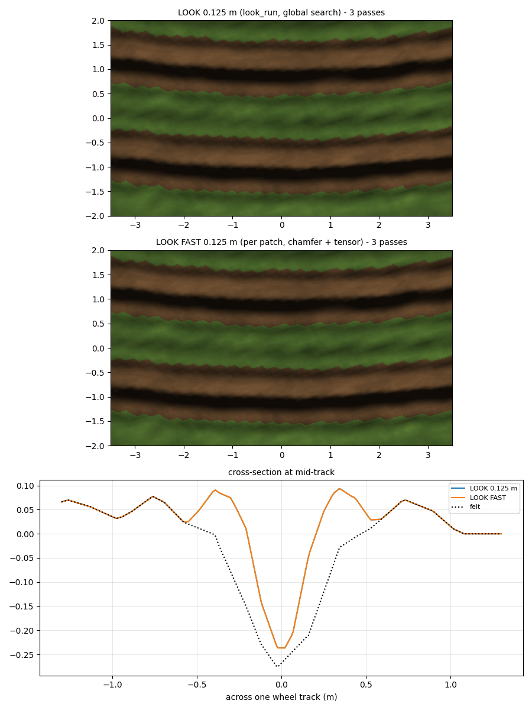

# Mud look Stage 1 - look_fast vs look_run (2026-10-17, offline)

Tool: `python Tools/mud_look_proto.py --fast` (look_fast + helpers in the same file). MEASURED offline, same drive and
constants as [2026-10-17-mud-look-proto.md](2026-10-17-mud-look-proto.md). Nothing in Scripts/ changed.

look_fast = what Enforce will run, per 8 m patch + 0.75 m margin on a 0.125 m grid (77 x 77 = 5929 samples):
- depth D = triangle sample of the rut floor (as the patch mesh), ridge the same;
- centre samples: D > 0.02 and D >= 0.9 x the 5 x 5 local max;
- lat + Dc: two-pass chamfer (4 neighbours per pass), each sample carries its nearest centre's x, z and depth;
- 5 x 5 box blur of lat and Dc (see "Blur" below);
- track direction: structure tensor of the depth gradient, 5 x 5 box (~0.6 m), main eigenvector = across, tangent
  perpendicular, fixed sign rule (tangent x > 0, or x = 0 and z > 0). No SVD, no global search;
- profile, dirt and drag: look_run's maths unchanged.

## Numbers
| Passes | Model | Depth m | Width 50 % m | Width 80 % m | Ridge m | Wall p95 deg | Shape vs SHEET | Dirt m2 | Over felt max m | Under felt out / in m |
|---|---|---|---|---|---|---|---|---|---|---|
| 1 | LOOK 0.125 m | 0.108 | 0.27 | 0.18 | 0.047 | 39 | 0.34 | 26.3 | 0.077 | 0.000 / -0.017 |
| 1 | LOOK FAST 0.125 m | 0.108 | 0.27 | 0.18 | 0.047 | 39 | 0.34 | 26.3 | 0.077 | 0.000 / -0.017 |
| 3 | LOOK 0.125 m | 0.196 | 0.22 | 0.13 | 0.094 | 57 | 0.19 | 27.0 | 0.186 | 0.000 / -0.057 |
| 3 | LOOK FAST 0.125 m | 0.196 | 0.22 | 0.13 | 0.094 | 57 | 0.19 | 27.0 | 0.186 | 0.000 / -0.057 |

| Passes | Y diff rms / p95 / max m (touched area) | Dirt same % | Drag angle diff median / p95 deg (n) | Patch seam max m (n border verts) |
|---|---|---|---|---|
| 1 | 0.0001 / 0.0003 / 0.0006 | 100.0 | 2.5 / 12.3 (1503) | 0.00000 (259) |
| 3 | 0.0002 / 0.0006 / 0.0016 | 100.0 | 2.4 / 9.6 (1386) | 0.00156 (259) |

Op estimate per patch (5929 samples = 8 m + 0.75 m margin at 0.125 m):

| Step | ops per sample |
|---|---|
| floor + ridge triangle samples (2 x ~12) | 24 |
| local max 5 x 5 separable (2 x 5) | 10 |
| chamfer 2 passes x 4 neighbours x ~8 | 64 |
| 5 x 5 blur lat + Dc separable (2 x 2 x 5) | 20 |
| gradient + 3 tensor products | 10 |
| tensor box 5 x 5 separable (3 x 2 x 5) | 30 |
| atan2 + sin + cos (count ~20 each) | 60 |
| profile (cos, sin, ~25 flops) | 60 |
| **total per patch** | **1648262** (~1.65 M) |

Second table: per-vertex |Y| difference look_run vs look_fast where either draws dirt; drag angle difference where
both drag > 0.05 m; seam = the same border vertex computed by two neighbour patches (each from its own margin).

## Reading
- **Pass.** Every table column is identical to look_run at both pass counts (limit was 10 %). Per vertex: 0.2 mm rms,
  1.6 mm worst. Dirt 100 % the same.
- **Blur: 5 x 5, not the plan's 3 x 3.** MEASURED with 3 x 3 (3 passes): depth 0.255 vs 0.196, width at half depth
  0.30 vs 0.22, wall 67 vs 57 deg = 30 % off. The ragged centre set needs the wider blur. Cost +8 ops per sample.
- **Drag direction:** median 2.4-2.5 deg off the SVD tangent, p95 10-12 deg (mostly at the groove ends).
- **Patch seams:** 0 at 1 pass, at most 1.6 mm at 3 passes (Dc carried from centres outside one patch's margin).
  The look patches get skirts anyway (user 2026-10-17), so a 1.6 mm crack cannot show.
- **Cost (ESTIMATE, not measured):** ~1.65 M simple operations per patch if every sample runs every step. Exact
  savings for Enforce: (a) samples farther than LOOK_BAND_OUT + blur (~0.62 m) from every centre come out as the
  felt ground with no drag (checked in the maths: tyre false, ridge weight 0, has-term 0), so tensor + profile run
  only near the track (~25 % of a rut patch for two tracks, INFERENCE); (b) the tensor eigenvector without
  atan2 / sin / cos: across = normalise(Jxx - Jzz + sqrt((Jxx - Jzz)^2 + 4 Jxz^2), 2 Jxz). Real ms only in the PERF
  session ('MUD look' line), never in Workbench.
