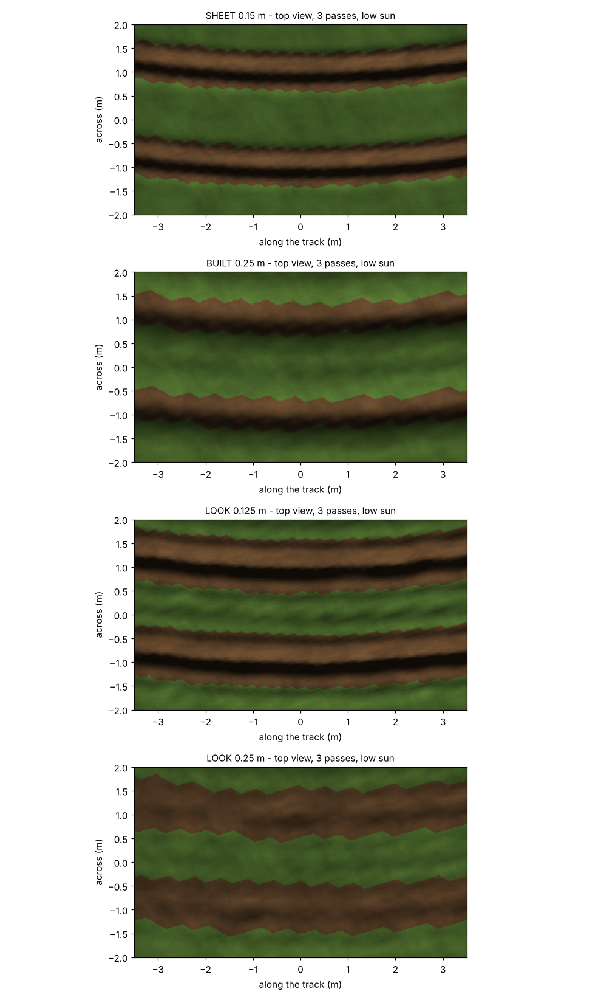
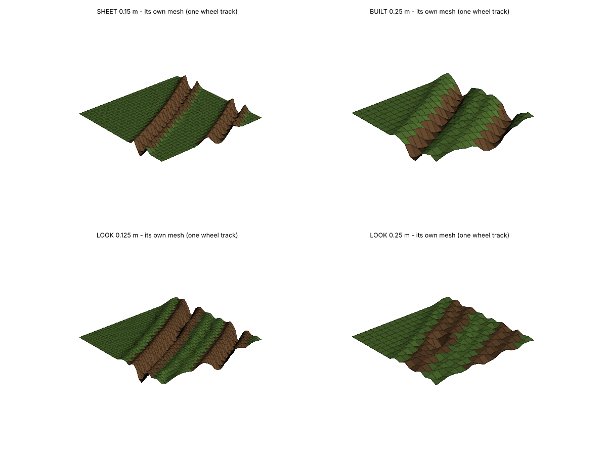
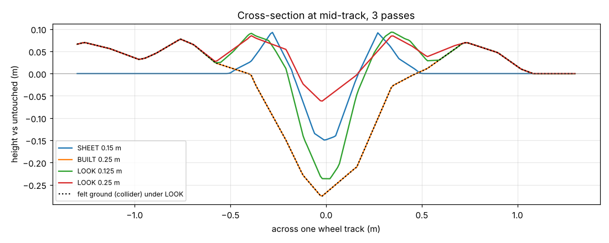

# Mud look prototype - sheet vs built vs a look layer (2026-10-17, offline)

Tool: `python Tools/mud_look_proto.py` (models and every constant in its docstring). MEASURED offline on copied game
maths (sheet: MUD_MudSheet.Stamp / Slump; built: CarveFloor via Tools/scm_lite_proto.py at ebe4527 values). Truck,
tyre and speed are ASSUMED round numbers. Nothing in Scripts/ changed. Images are a stand-in renderer (procedural
texture, low sun, smooth vertex normals) - they compare SHAPE, mesh detail, dirt edge and drag, not the game's
materials.

## Numbers (5 cross-sections at mid-track, one wheel track, averaged)
| Passes | Model | Depth m | Width at 50 % depth m | Width at 80 % depth m | Ridge m | Wall slope p95 deg | Shape vs SHEET (0 = same) | Dirt area m2 | Drawn over felt max m | Drawn under felt: outside / inside tyre strip m |
|---|---|---|---|---|---|---|---|---|---|---|
| 1 | SHEET 0.15 m | 0.050 | 0.15 | 0.09 | 0.043 | 35 | 0.00 | 12.1 | - | - |
| 1 | BUILT 0.25 m | 0.133 | 0.44 | 0.26 | 0.039 | 28 | 0.46 | 12.4 | - | - |
| 1 | LOOK 0.125 m | 0.108 | 0.27 | 0.18 | 0.047 | 39 | 0.34 | 26.3 | 0.077 | 0.000 / -0.017 |
| 1 | LOOK 0.25 m | 0.042 | 0.18 | 0.08 | 0.044 | 19 | 0.55 | 25.1 | 0.104 | 0.000 / -0.078 |
| 3 | SHEET 0.15 m | 0.146 | 0.22 | 0.14 | 0.095 | 56 | 0.00 | 20.0 | - | - |
| 3 | BUILT 0.25 m | 0.266 | 0.46 | 0.28 | 0.076 | 44 | 0.35 | 15.1 | - | - |
| 3 | LOOK 0.125 m | 0.196 | 0.22 | 0.13 | 0.094 | 57 | 0.19 | 27.0 | 0.186 | 0.000 / -0.057 |
| 3 | LOOK 0.25 m | 0.022 | 0.06 | 0.02 | 0.092 | 11 | 0.73 | 23.1 | 0.264 | 0.000 / -0.195 |

Columns: depth = deepest drawn point; widths = across the track where the drawn surface is under 50 / 80 % of that
depth (80 % = how flat-bottomed the groove is); ridge = highest drawn point; wall slope = 95th percentile of the
drawn slope inside the rut; shape vs SHEET = rms of the two cross-sections each scaled to its own depth; dirt area
= mud-coloured area in the 16 x 16 m window; drawn over / under felt = how far the LOOK mesh sits above / below the
ground wheels and feet stand on (over = feet / tyre hidden in drawn mud; under = something would float over the drawn
ground - kept at 0 outside the tyre strip by design).

## Reading (3 passes, heavy truck)
- **Today's felt rut is not the sheet look, by the numbers.** BUILT is twice as wide (0.46 m at half depth vs the
  sheet's 0.22), softer walls (44 vs 56 deg), ridges stay grass and sit 0.5-1.0 m out, shape distance 0.35.
- **A look layer at 0.125 m gets close.** LOOK 0.125 m: groove 0.22 m wide at half depth (sheet 0.22), walls 57 deg
  (sheet 56), dirt ridge 0.09 m right at the groove wall (sheet 0.095), shape distance 0.19 (built 0.35). It is
  deeper than the sheet (0.20 vs 0.15) because it follows the felt depth - LOOK_RIDGE_K / a depth scale tune that.
- **On today's 0.25 m mesh it does NOT work.** LOOK 0.25 m: the 0.42 m groove falls between vertices - spiky
  mesh, depth 0.02 m, shape distance 0.73. A finer mesh near the camera is required, not optional.
- **The price: drawn mud over the felt ground.** The felt bowl is wide and the drawn groove narrow, so on the bowl
  walls the drawn ridge sits up to ~0.19 m over the ground feet and wheels stand on: a soldier there has their feet in
  drawn mud (MudRunner does the same: drawn mud over hard ground). Nothing floats outside the tyre strip (0.000);
  inside it the drawn floor sits 0.02-0.06 m over the felt floor (the tyre looks a little sunk, never floats).
- **The felt ridge stays visible** as a low grass hump 0.5-1.0 m out (it is in the collider, so it must be drawn).
  One ridge instead of two would need the felt ridge moved next to the rut (felt change, MP robot) or switched off
  while the look layer is on - a choice to make.
- Bow wave / front push: the sheet's push ahead of the tyre is transient (only while the truck is there) and is not
  derivable from the floor - not in the look layer.
- 1 pass: the look follows the felt rut's first big step (R4 share 0.4), so it starts deeper than the sheet's
  gradual 0.05 m press.

## What it would take in the game (ESTIMATE / INFERENCE - not measured)
- Client only, no op / net / snapshot change: the look is computed from the rut floor + ridge every client already
  has (J2-safe, late joiners get it for free). A DS never builds it.
- Near the camera only (e.g. rutted patches within ~20 m): their MESH at 0.125 m = 65 x 65 = 4225 vertices / 8192
  triangles per 8 m patch (4x today's 33 x 33). The collider stays 0.25 m. Mesh build ~4x today's grid mesh time
  plus the per-vertex look maths (centre search, blur) - must be measured in a PERF session, never in Workbench.
- Texture drag = per-vertex UV offsets along the track (allowed: one UV set, clamped 0..1 per patch), dirt = the
  existing soil section with a lower threshold under the look.
- Open: patch edges (the look needs the floor 0.5 m past the patch), crossing tracks (centre search picks the
  deepest), how far away the switch to the coarse mesh shows (LOD pop).
