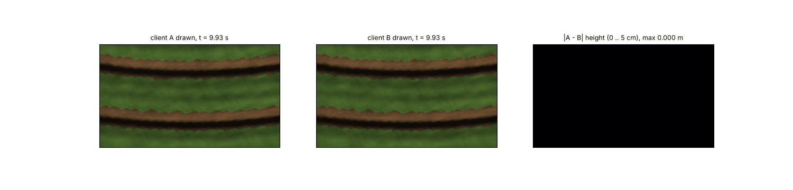
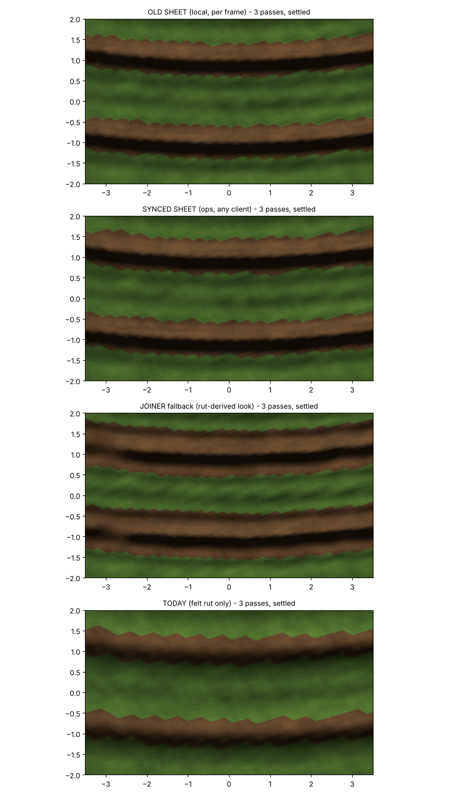
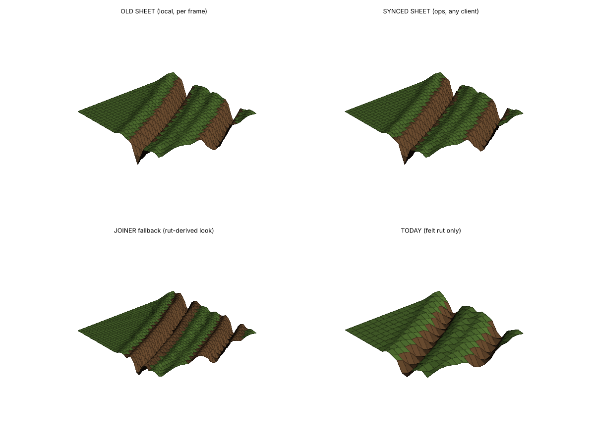
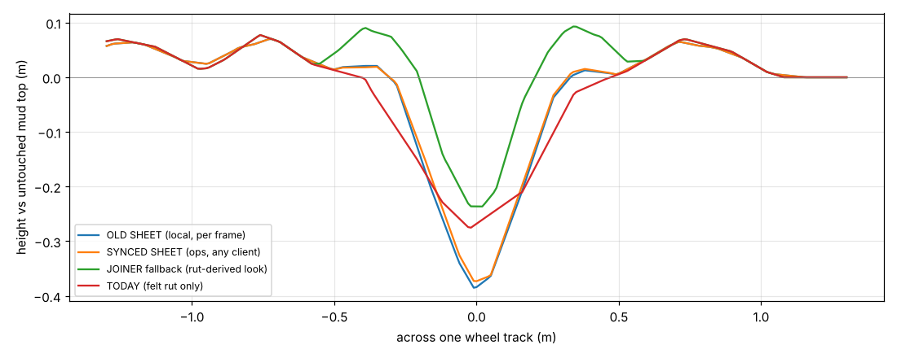

# Synced mud sheet prototype (2026-10-17, offline)

Tool: `python Tools/mud_sheet_sync_proto.py` (setup in its docstring). MEASURED offline on copied game maths
(MUD_MudSheet Stamp / Slump; CarveFloor via Tools/scm_lite_proto.py, ebe4527 values). Truck, latencies, view errors
are ASSUMED round numbers. Nothing in Scripts/ changed. Stand-in renderer (procedural texture, low sun).

| Check | Result |
|---|---|
| Rut ops (3 passes) | 24 |
| SYNC layer client A vs B after all ops (max abs diff) | 0.000000 m |
| Felt rut field A vs B (max abs diff) | 0.000000 m |
| Handoff jump when an op replaces the prediction: median / p95 / max | 0.058 / 0.098 / 0.148 m |
| Area that jumps > 1 cm per handoff: median / max | 1.71 / 4.09 m2 |
| Synced vs old sheet, settled, 8 x 5 m window: rms / max | 0.006 / 0.039 m |

| Model | Depth m | Width at 50 % m | Width at 80 % m | Ridge m | Wall p95 deg | Shape vs OLD SHEET | Dirt m2 |
|---|---|---|---|---|---|---|---|
| OLD SHEET (local, per frame) | 0.379 | 0.32 | 0.16 | 0.072 | 57 | 0.00 | 23.8 |
| SYNCED SHEET (ops, any client) | 0.378 | 0.32 | 0.16 | 0.072 | 57 | 0.01 | 25.3 |
| JOINER fallback (rut-derived look) | 0.214 | 0.22 | 0.14 | 0.094 | 60 | 0.18 | 33.8 |
| TODAY (felt rut only) | 0.267 | 0.47 | 0.28 | 0.076 | 44 | 0.11 | 18.8 |

## Reading
- **Every client ends up with the same mud.** Pressing the sheet only from the replicated rut ops (in op order, slump
  a fixed 3 iterations per op) gives client A and B bit-identical sheets and rut fields after the last op (max diff
  0.000000 m), whatever their latency or view of the truck.
- **It still looks like the old sheet.** Settled, the synced sheet is within 6 mm rms (3.9 cm max) of the old
  per-frame sheet in the 8 x 5 m window; groove width, walls, ridge and dirt are the same (shape distance 0.01).
  Op segments of 0.5 m are fine-grained enough (stamping them in 0.125 m pieces changed nothing).
- **The live part stays live.** Each client stamps its own view of the wheels every frame (press, bow wave, ridge
  at the tyre at once), then the op version replaces it (rollback + replay).
- **The handoff jump:** median 6 cm, p95 10 cm, on ~1.7 m2, 1.5-2 m behind the tyre (where RUT_BEHIND cuts),
  morphed out over ~0.25 s. Sources, measured with a sweep (scratch runs, same tool):
  - the client's view of the truck being off sideways (+-3 cm here) - with no view error the median is 3.6 cm, at
    +-10 cm it is 9.8 cm;
  - mud slumping into the felt rut the op just cut (area 1.2 m2 with slump on vs 0.04 m2 off).
  It is a groove section shifting a few cm sideways, not mud appearing or vanishing. Whether it is visible needs
  the game.
- **While the truck is there, two clients differ** (gif, right panel: up to ~0.17 m for a fraction of a second
  behind the truck): one client got the op (and its felt rut cut) ~60 ms earlier, and each sees the truck at its
  own interpolated place. This is the same as today's felt ruts (each client applies an op when it arrives). It goes
  to 0 when the op reaches both.
- **Felt rut under the mud:** drawn = felt ground + mud depth, so tyres always sit at the bottom of the mud and the
  felt rut deepens the drawn rut 1.5 m behind the truck (depth 0.38 m after 3 passes = felt 0.27 + mud press).
  Option (not in the proto): let the mud fill the felt cut (depth += felt drop), so the drawn top does not drop and
  tyres look sunk deeper - a look choice.
- **Late joiners do NOT get the sheet from the J2 snapshot** (it has the floor, not the op segments). Fallback
  shown: the rut-derived look (shape distance 0.18 to the sheet, the bottom-but-one picture). A real fix = the
  snapshot also carries the touched mud cells (ESTIMATE: ~1.2 m of touched strip per wheel track, 0.15 m cells,
  ~3 bytes each -> roughly 0.1-0.3 MB per km of tracks before compression) - a later choice.

## What is NOT shown / still open
- Cost per frame in the game (stamps per op: 2 wheels x ~4 segments; prediction replays ~20-25 local stamps per op
  arrival; tile mesh rebuilds near the camera) - PERF session only.
- Pass start must be deterministic: the sheet used a clock (PASS_GAP 4 s); the proto puts a pass number in the op.
  In the game: per-cell "last op seq + vehicle" instead of time.
- Speed for the ridge height must travel in the op (proto: 0.1 m/s field). Tyre half width too if it should vary
  by vehicle (proto: one truck).
- Where mud is (zones or the terrain gamemat), the mud edge (TAPER), and craters / trenches clearing mud: the old
  sheet's rules, unchanged, look-only now.
- Animation: the gif is the stand-in renderer, 0.04 m pixels, 12 fps.
